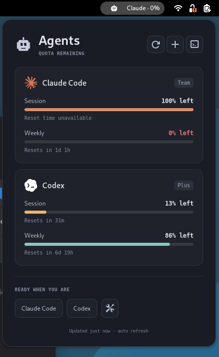

# Verification — November 6, 2026

Target: Debian 13, GNOME Shell 48.7, Wayland.

## Automated

- Python standard-library suite: **23 tests passed**, including real subprocess JSON-RPC handshake, timeouts, whole-reader deadline, SIGTERM with a stalled HTTP worker, child-process termination, account changes during a fetch, private cache permissions, identity isolation, auth renewal, timezone conversion and quota normalization.
- GJS suite: **30 assertions passed**, including percentages remaining, conservative rounding, expired/unknown allowances, restrictive overall windows, stale reader errors and reset formatting.
- Strict GSettings schema compilation and GNOME extension packaging passed.
- Independent read-only review found three important issues: account-change cache attribution, collector cancellation, and stale UI state following reader failure. Each received regression coverage and was corrected; the final suites passed. The review's timezone and refresh-interval findings were also corrected.

## GNOME runtime

The actual extension loaded in an isolated GNOME Shell **48.7** Wayland session, using a separate D-Bus session and XDG config/data/runtime directories. A temporary harness enabled introspection only in that isolated session; no harness or unsafe-mode change was installed in the user's desktop.

- Extension state **1 (enabled)**; extension error list empty.
- Four live quota rows displayed, Claude before Codex; top bar `Claude · 0%` matched the lower general allowance.
- Inspected dark and light screenshots; checked brand marks, meters, plan badges, reset labels and footer.
- Opened and visually inspected the real libadwaita preferences window.
- Simulated a reader failure: top bar changed to `Claude · ~0%`; failure footer persisted through a label update.
- Disabled while a collector was running: process terminated, active false, process reference null, both refresh/clock timers zero. Re-enabled successfully with no extension errors.

The first test session incorrectly shared the dconf service configuration. The pre-existing list of 12 active extensions was restored, animations were restored to the enabled state used by the user's Just Perfection configuration, and subsequent testing used fully isolated XDG directories. The actual install adds only `agents@tomydng.local` to those 12 enabled extensions.

## Installation

Installed to `~/.local/share/gnome-shell/extensions/agents@tomydng.local/`; compiled settings schema included. Distributable: `dist/agents@tomydng.local.shell-extension.zip`.

The running desktop has not discovered this newly installed extension yet. Enablement is queued; **one logout/login is required**. The desktop was never restarted or logged out automatically. Screenshots show the isolated test session, not an already-loaded extension in the user's current desktop.

Claude's normal CLI `auth status` renewed its existing sign-in without a new login or a model request. Both Claude and Codex subsequently returned real account quota. At the time of verification Claude reported 0% weekly quota remaining, even though its session allowance was unused; the top bar therefore correctly showed 0%.

